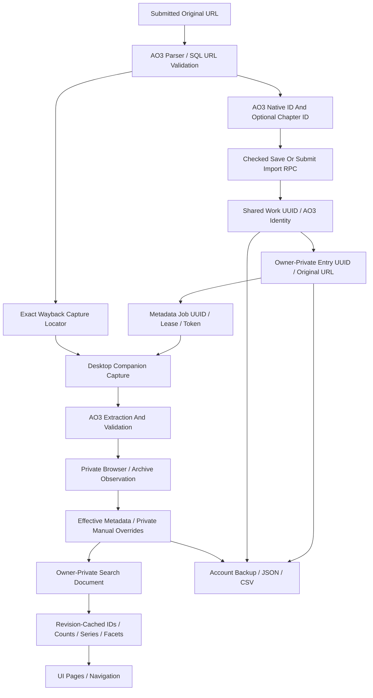

# Source Data Flow And SQL Dependencies

Status: observed working-tree architecture, with future insertion points explicitly identified. [Inventory IDs](source-assumptions.md#coupling-inventory) connect this map to risks; [contracts](source-contracts.md) describe proposed vocabulary.

## End-To-End Identity Flow



URL normalization does not prove existence. The current chain retires hosted direct work retrieval; browser/archive observations commit privately. Historical direct snapshots remain readable. A deleted bookmark can enter with a shared UUID but no AO3 work number. EPUB recovery supplies reviewed private metadata through the existing save boundary; it does not upload chapter prose or establish shared source verification.

## Stage Boundaries And Extension Points

| Stage | Implemented Boundary / Consumer | Future Insertion Point And Preservation Requirement |
| --- | --- | --- |
| Discovery | `urls.ts`: `parseWorkUrl`, `classifyUrl`, `extractUrls`, `groupWorks`; SQL `submit_import`/`save_library_story` independently validate | Select source before invoking its URL parser; keep SQL independently authoritative. No broader regex acceptance without persistence support. Preserve exact original URLs and archived-target dedup. |
| Acquisition: Retired Direct Path | `20261109000300_extension_only_retrieval.sql`: `claim_metadata_job` returns NULL; import-worker entrypoints are retired; parser helpers remain | Do not revive hosted work retrieval for readiness. A future provider needs an explicitly supported acquisition path; retain leases and trusted completion checks. |
| Acquisition: Browser | `src/features/imports/extension.ts`; Chrome `background.js`, `capture.js`; `server/ao3/extension-handler.ts`; `supabase/functions/extension-metadata/index.ts` | Browser acquisition remains separate from provider parser. Keep owner-bound live lease, request bounds, sender/environment checks and returned identity validation. No new host permissions in A. |
| Acquisition: Other | `ao3-csv.ts`, `sample-import.ts`, `imports/epub.ts`; `server/ao3/series-handler.ts`; `server/ao3/wayback.ts` | Retain CSV review, local EPUB partial metadata and archive locator semantics. Series previews and Wayback lookup are distinct from ordinary work acquisition. No speculative common fetcher. |
| Extraction | `extractWorkMetadata` reused by `parseMetadata` and companions; `ao3-series.ts`, `server/ao3/series.ts`; `parseTagResolution` | Add source-specific extraction beside AO3 only when chosen. Require identity proof and partial-field fixtures; parser code must not know personal reading state. |
| Normalization | `validateMetadata`, `AutomaticMetadata`; SQL `nonempty_ao3_metadata`; effective metadata in `model.ts` / `library_story_documents` | Adapt raw observations/categories/authority here once. Do not make UI or matcher guess provenance from label. Preserve private override precedence and omitted unknowns. |
| Persistence | `supabaseJobStore.finish` → `finish_metadata_job`; userscript device path → `userscript_library`; manual `save_library_story_checked` → save | Keep service-role-only shared mutations and owner/device checks. Source-qualified validation belongs at trusted mutation boundaries, not just TypeScript. |
| Presentation | `ImportLinkForm`, `CsvImportForm`, `SeriesImportReview`, `useMetadataRefresh`, `StoryForm`, shared library tiles/details/filters | Reuse current error/review/edit/feedback components; expose only verified capabilities. Unknown metadata remains editable and does not imply deletion. |

## Acquisition Outcomes

Current `RetrievalResult.category` is a string; it is serialized into processing logs and import items. A new enum now would break no demonstrated duplication and is deferred. Proposed neutral terms are documentation aliases only:

| Proposed Term | Existing Outcome / Handling |
| --- | --- |
| `unsupported_url` | `classifyUrl`: unrelated/invalid/unsupported; adapter `invalid_identity`; submission can reject/track unsupported items. Do not enqueue an arbitrary origin. |
| `authentication_required` | `restricted`; browser `extension_waiting` and listing attention `login`; retain user action/retry rather than bypass restrictions. |
| `unavailable` | `unavailable`, verified AO3 `not_found`; archive absence remains unavailable. Explicit `mark_work_deleted` owner action rather than deleting on an ambiguous HTTP failure. |
| `rate_limited` | `rate_limited`, `blocked`; global database pacing/pause, retries bounded. Blocking challenges are distinct from ordinary 429s. |
| `parse_changed` | `parser_failure`, `changed_identity`, invalid MIME/body/redirect results. Keep identity mismatch distinct from transient network retry. |
| `transient_failure` | `temporary_unavailable`, `network_error`, `timeout`, `http_error`; existing retryability and messages govern. |
| Partial success | `partial`, `chapter_dates_unavailable`, `unverified_chapter`; preserve usable metadata and avoid fabricated progress. Do not collapse partial into empty or complete success. |

## Active SQL And Projection Map

The ordered chain was executed in PGlite and resolved definitions inspected. Many migrations use `pg_get_functiondef`/text replacement; the original `CREATE FUNCTION` file alone is not the active definition. Key dependency groups:

| Migration Files (Under `supabase/migrations/`) | Functions / Objects And Current Consequence |
| --- | --- |
| `20261014000100_foundation.sql`, `20261015000100_core_library.sql`, `20261016000100_restore_library_story.sql` | Shared `works` UUID/native ID/canonical constraint, private entries and FKs; `save_library_story`, `restore_library_story`, validation/identity triggers and forced RLS. |
| `20261016000200_bulk_imports.sql` through `20261016000800_existing_import_reading_location.sql` | Jobs/items, `submit_import`, `claim_metadata_job`, `finish_metadata_job`, extension claims, verified progress. Later repairs/Wayback patches are essential. |
| `20261019000201_safe_library_edits.sql`, `20261019000300_library_series.sql`, `20261019000400_series_organization.sql` | Checked/conflict-aware saves, series UUID vs AO3 series number, private memberships. |
| `20261020000100_library_query.sql`, `20261021000100_automatic_collections.sql`, `20261025000400_catalog_collection_evaluation.sql`, `20261025000500_collection_query_work.sql` | `library_story_documents` view → `refresh_library_documents`, document synchronization/flush; `library_filter`, search/collection rule evaluation. Private effective metadata is authoritative, not bare shared work metadata. |
| `20261021000700_library_backups.sql` through `20261021001000_account_backup_restore.sql` | Export/validate/preview/restore, private source snapshots, safety-copy gate, shared-identity remapping, jobs fenced on restore. |
| `20261022000300_ao3_csv_import.sql` through `20261022000800_preserve_bookmark_observations.sql`; `20261026000600_repeat_import_repairs.sql` | Source observations, nullable AO3 work ID/deleted bookmarks, private repair and original URL rules. |
| `20261024000500_chapter_read_history.sql`, `20261028000500_chapter_read_batches_and_undo.sql`, `20261029000300_compact_reading_stats.sql` | History/event identity, chapter position/word evidence, compact archived/active stats projections. |
| `20261026000300_incremental_library_loading.sql`, `20261026000400_compact_navigation_series.sql`, `20261026000500_library_query_payloads.sql` | Paged payloads/catalog/navigation; do not derive architecture from the earliest full-catalog frontend alone. |
| `20261026000700_canonical_tag_suggestions.sql` | `ao3_tag_resolutions`, `store_tag_resolutions`, `reserve_tag_resolution`, `library_tag_aliases`, `library_alias_filters`, `library_alias_rules`, `library_tag_matches`; explicit AO3 authority, per-owner cache. |
| `20261027000200_indexed_library_navigation.sql`, `20261027000300_library_query_cache_write_access.sql` | `index_library_document`, indexed fields; `automatic_collection_works`, `refresh_automatic_memberships`; `library_query_state`, `invalidate_library_queries`, `sync_library_query_state`; private `library_query_cache`, `library_candidate_predicate`, `library_query_work_sql`, `library_query_matches`, `library_navigation_snapshot`. Query cache writers must be VOLATILE under PostgREST. |
| `20261027000500_wayback_work_imports.sql`, `20261028000300_wayback_deleted_status.sql` | `ao3_source_target`, service-only `metadata_job_archive_source`; save/import/undo/claim/finish validation patches and private Deleted availability. |
| `20261027000600_series_query_evaluation.sql`, `20261027000700_series_grouped_inputs.sql`, `20261028000100_projected_series_documents.sql`, `20261028000200_series_relational_groups.sql`, `20261028000400_revision_cached_series.sql` | Materialized compact series inputs/pools, `library_series_input`, `library_query_pool`, `library_cached_series`; owner/revision-scoped bounded cache, advisory locks. |
| `20261028000600_compact_library_catalog.sql`, `20261028000700_batch_listing_documents.sql`, `20261028000800_trim_series_chapter_dates.sql`, `20261028000900_inferred_series_minimum.sql` | Stored `catalog_story` and `series_story`, deferred document batching; omit large chapter maps in series inputs; two-work inference threshold. |
| `20261029000200_reader_offline_hub.sql` through `20261031001100_private_beta_allowlist.sql` | Reader access/cloud/transfers, account/device auth and availability, tag appearance and signup. These preserve separate owner-private boundaries; they do not introduce fiction-source providers. |
| `20261101000100_scoped_reading_reviews.sql` through `20261102000300_reader_shared_markings.sql` | Scoped review/history and reader progress/marking behavior; current reader sync is not fully described by October notes. |
| `20261102000400_reading_filters_and_series_search.sql` | Actual legacy `library_crossover`, plural `crossovers` filter, collection validator, per-member series crossover booleans; **not hierarchy evidence**. |
| `20261103000100_cached_series_text_search.sql`, `20261103000200_offline_collections.sql`, `20261104000100_reader_anthology_links.sql` | Cached series text, offline collections and anthology source-member association. |
| `20261104000200_cached_facets_and_reader_platforms.sql`, `20261104000300_remove_reader_installation_reports.sql` | Stored `facet_story`, `library_facet_document`, cached `library_query_facets`/`library_uncached_facets`; owner/revision scope plus availability predicates keyed by AO3 reader IDs; installation-report changes. |
| `20261109000100_work_id_search.sql` | Patches active shared `library_filter` to append `ao3_work_id` to title/author query text; clears old cache rows. Included in working-tree tests, not proof of deployed migration. |

The B1-R replay on 10 November 2026 also includes `20261109000200_tag_expressions.sql` (expression normalization/groups, shared predicate, rule validation, selection guard and public query preparation) and `20261109000300_extension_only_retrieval.sql` (retired hosted work claims). The latter does not replace matching/projection functions. Active `library_tag_matches` maps only the three supported metadata categories; other categories cannot inherit freeform aliases. `query_library` discards caller `tagAliases`/`tagGroups` before preparing trusted owner-scoped inputs.

## Matcher Consumers And Invalidation

Current local path: `filterReading` → `matchesTagExpression` → `tagNames`/`tagMatches` with explicit AO3 authority; automatic collections reuse the reading predicate; `series-search.ts` evaluates member-specific filters and shared merged text; ReadingDashboard powers library/reading/author views. URL/default/draft state lives in `browsing/browsing.ts`, `filter-defaults.ts` and shared draft controls. Sample mode and retained offline hub use local evaluation. `useTagResolutions` loads an account-scoped paginated AO3 cache for suggestions/ordering and emits `ao3-tag-resolutions-updated`; it does not build/inject a local matching alias index. `filterReading` accepts an optional prevalidated index (including SQL parity tests); sample/offline evaluation without it uses raw fallback. Suggestions/fandom counts use existing facet scope rather than arbitrary UI result slices.

SQL path: authenticated query prepares `library_alias_filters` and parsed terms → candidate predicate narrows owner/shelf/author/reader availability → `library_filter` runs **before** matching IDs/counts/page selection → compact payload hydration. Series uses `library_query_pool` / cached series merger and the same filter contract. Automatic membership uses `library_alias_rules` and the same effective document. Preserve these semantics, including facets' intentional scoped suggestion universe rather than assuming facets equal current filtered-result counts.

Source/entry/relation changes → `library_story_documents` → `refresh_library_documents` (or deferred ID collection + `flush_library_documents`) → `library_search_documents.story` → indexed fields and stored `series_story`, `catalog_story`, `facet_story` → `sync_library_query_state` → owner revision and `refresh_automatic_memberships`. Collection rule changes refresh relevant memberships. Tag authority updates use `store_tag_resolutions` batching and refresh all affected owner's memberships/revision; timestamp-only changes do not invalidate matches. Query matches, navigation, facets and series pools are owner/revision scoped with a 20-entry server cache bound. Frontend caches/subscriptions also need an observed revision/refetch; changing a server row alone cannot update a mounted offline snapshot.

For planned hierarchy evidence, **no such trigger/queue exists yet**. Public evidence changes must find affected owner-effective fandom observations and regenerate their classifier projection, membership, and revisions in a consistent transaction/bounded batch. Do not update only `works`, only a cache timestamp, or only the displayed status. Generated projectors currently select explicit fields: new status/evidence input must survive every projector needed for work, series, catalog, facet and offline evaluation. Negative-proof expiry requires scheduled invalidation even without a new successful fetch. Reuse existing revisions; do not add another cache family or per-row external lookup.

Performance-sensitive functions: `library_query_candidates`, `library_candidate_predicate`, `library_query_work_sql`, `library_query_matches`, `library_filter`, `library_query_pool`, `library_cached_series`, series merger/input projectors, `library_query_facets`, `refresh_automatic_memberships`, and document/revision triggers. Additional identity joins, owner fan-out, JSON normalization or full closure traversal here can amplify a 10,000-work scan. A later feature requires SQL plans, cold/warm benchmarks, concurrent owner tests and the existing performance scripts; Phase A makes no performance improvement claim.

## Security Boundaries

Forced RLS and grants apply to both private and shared relations. Authenticated shared reads are constrained by the established schema policies; browser clients cannot write shared metadata/evidence directly. Private entry/membership/query reads are owner-scoped. `SECURITY DEFINER` is not a substitute for authorization: save/restore/query paths derive `auth.uid()`, userscript paths validate the paired device secret and derive its owner, and workers use service-role-only RPCs with live lease tokens. Retain empty/search-path hardening, grants, parameterized dynamic SQL, immutable work association and checked edits. Never accept client-provided canonical status, arbitrary owner UUID, or cached identities as permission to read another account.

A future shared fandom cache may hold public AO3 facts only. Lookup request rows, effective overrides, private membership lists and derived entry status remain owner-private. Test both direct table access and definer RPCs, including caller-supplied owner parameters. No RLS/authorization rule changes in A.

## Complete Ordered Migration Ledger

This is the local input order used by `scripts/test-database.mjs`, rechecked in B1-R on 10 November 2026: 123 migrations through extension-only retrieval. The grouped map above explains relevant supersession; this ledger does not assert hosted installation. The [readiness assessment](filter-source-readiness.md) records resolved projection fields and future integration gates.

```text
20261014000100_foundation.sql
20261015000100_core_library.sql
20261016000100_restore_library_story.sql
20261016000200_bulk_imports.sql
20261016000300_static_metadata_updates.sql
20261016000400_explicit_tag_category_cast.sql
20261016000500_preserve_source_tag_order.sql
20261016000600_extension_imports.sql
20261016000700_chapter_import_progress.sql
20261016000800_existing_import_reading_location.sql
20261016000900_collection_appearance.sql
20261017000100_collection_order.sql
20261017000200_collection_story_activity.sql
20261018000100_series_previews.sql
20261018000200_userscript_devices.sql
20261018000300_abandoned_fics.sql
20261019000100_userscript_metadata_refresh.sql
20261019000200_one_shot_override.sql
20261019000201_safe_library_edits.sql
20261019000300_library_series.sql
20261019000400_series_organization.sql
20261019000500_finish_saved_series_works.sql
20261019000600_import_reading_status.sql
20261020000100_library_query.sql
20261020000200_import_history_and_fairness.sql
20261020000300_bound_metadata_documents.sql
20261020000400_optional_series_details.sql
20261020000500_missing_series_update_date.sql
20261020000600_inferred_series_results.sql
20261020000700_continue_later_status.sql
20261020000800_continue_later_shelf.sql
20261020000900_paused_reading.sql
20261021000100_automatic_collections.sql
20261021000200_automatic_collection_author_search.sql
20261021000300_random_library_sort.sql
20261021000400_kudos_metadata.sql
20261021000500_collection_options.sql
20261021000600_starter_one_shots_collection.sql
20261021000700_library_backups.sql
20261021000800_saved_library_backups.sql
20261021000900_backup_retention.sql
20261021001000_account_backup_restore.sql
20261022000100_reading_history.sql
20261022000200_userscript_series.sql
20261022000300_ao3_csv_import.sql
20261022000400_library_sync.sql
20261022000500_refresh_listing_metadata.sql
20261022000600_deleted_bookmarks.sql
20261022000700_deleted_publication_status.sql
20261022000800_preserve_bookmark_observations.sql
20261022000900_personal_filters_and_bookmark_recs.sql
20261022001000_series_browsing_filters.sql
20261022001100_editable_recs.sql
20261023000100_series_recommendations_and_list_status.sql
20261023000200_optional_bookmark_chapter_dates.sql
20261023000300_bookmark_historical_dates.sql
20261023000400_formatted_work_summaries.sql
20261023000500_complete_ao3_metadata.sql
20261024000100_shared_personal_rating_info.sql
20261024000200_dnf_cleanup.sql
20261024000300_library_sync_reports.sql
20261024000400_import_request_history.sql
20261024000500_chapter_read_history.sql
20261025000100_library_sync_report_rls.sql
20261025000200_mobile_metadata_retrieval.sql
20261025000300_reading_session_dates.sql
20261025000400_catalog_collection_evaluation.sql
20261025000500_collection_query_work.sql
20261025000600_personal_tag_filters.sql
20261026000100_author_library_pages.sql
20261026000200_persistent_companion_pairings.sql
20261026000300_incremental_library_loading.sql
20261026000400_compact_navigation_series.sql
20261026000500_library_query_payloads.sql
20261026000600_repeat_import_repairs.sql
20261026000700_canonical_tag_suggestions.sql
20261027000100_companion_personal_flags.sql
20261027000200_indexed_library_navigation.sql
20261027000300_library_query_cache_write_access.sql
20261027000400_library_sync_bookmark_choices.sql
20261027000500_wayback_work_imports.sql
20261027000600_series_query_evaluation.sql
20261027000700_series_grouped_inputs.sql
20261028000100_projected_series_documents.sql
20261028000200_series_relational_groups.sql
20261028000300_wayback_deleted_status.sql
20261028000400_revision_cached_series.sql
20261028000500_chapter_read_batches_and_undo.sql
20261028000600_compact_library_catalog.sql
20261028000700_batch_listing_documents.sql
20261028000800_trim_series_chapter_dates.sql
20261028000900_inferred_series_minimum.sql
20261029000100_shared_tag_appearance.sql
20261029000200_reader_offline_hub.sql
20261029000300_compact_reading_stats.sql
20261030000100_reader_cloud.sql
20261030000200_reader_calibre.sql
20261030000300_reader_deletion_and_invited_access.sql
20261031000100_reader_account_connection.sql
20261031000200_tag_category_order.sql
20261031000300_reuse_reader_connections.sql
20261031000400_reader_installation_identity.sql
20261031000500_username_login.sql
20261031000600_self_service_usernames.sql
20261031000700_force_username_rls.sql
20261031000800_explicit_connected_login.sql
20261031000900_account_registration.sql
20261031001000_validate_reader_account_connection.sql
20261031001100_private_beta_allowlist.sql
20261101000100_scoped_reading_reviews.sql
20261101000200_reader_cloud_hub.sql
20261102000100_account_password_state.sql
20261102000200_reader_explicit_progress.sql
20261102000300_reader_shared_markings.sql
20261102000400_reading_filters_and_series_search.sql
20261103000100_cached_series_text_search.sql
20261103000200_offline_collections.sql
20261104000100_reader_anthology_links.sql
20261104000200_cached_facets_and_reader_platforms.sql
20261104000300_remove_reader_installation_reports.sql
20261109000100_work_id_search.sql
20261109000200_tag_expressions.sql
20261109000300_extension_only_retrieval.sql
```
