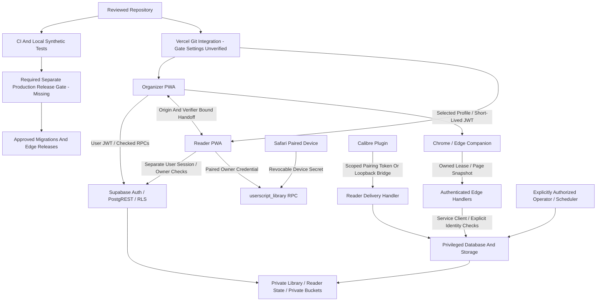

# S0 — Security And Environment Baseline Audit

**Status:** S0 conditionally approved as an audit deliverable. The findings below are the historical S0 snapshot; subsequent authorized local work is recorded in [S1 Local Isolation](S1_LOCAL_ISOLATION.md). This audit does not authorize hosted changes or S2–S4. **Date:** 13 November 2026. **Branch:** `infra/00-environment-audit`. **Base:** refreshed `main` / `origin/main` at `4d225ab9f064495bf195be7b8408805e16fc4a2a`; working tree was clean before branch creation. No push, merge, deployment, hosted resource creation, migration application, credential rotation, production configuration change, or production data copy was performed.

The existing hosted Supabase project is **production with real personal data**, regardless of user count or beta status. This report labels it **P** and withholds its project ref and all credential values. Public organizer: `https://beyondthearchives.vercel.app`; public reader: `https://archivesunfolded.vercel.app`. A public URL/key identifies a backend; it neither establishes environment isolation nor grants access to a private account.

## Scope And Evidence Rules

Read the external approved design inputs at workspace `to_implement/security-foundation/SECURITY_ENVIRONMENT_SPECIFICATION.md` and `SECURITY_ENVIRONMENT_IMPLEMENTATION_PLAN.md`. Their SHA-256 digests are respectively `6a46ef37dd342fa63ff78840e3730cfcc6f7a2b691d6fb5c2a41c23c18df3acf` and `336b39c35d5b2adb2f41ca3e461d4ea801719d02c26c3fd9aac937791d7ecf66`. They remain external planning inputs, not duplicated implementation documents. The referenced older `beyond-the-archives-environments/ENVIRONMENT_ISOLATION_*` files were not found in this Projects workspace. Individual legacy E0–E5 checklist mapping remains blocked until those inputs are supplied; the area mapping below is not item-level proof.

Audited the current [project specification](../PROJECT_OVERVIEW.md), [operations guide](../IMPLEMENTATION.md), [backup guide](../BACKUPS.md), [reader contract](../../reader/docs/IMPLEMENTATION.md), [retrieval cutover](../REMOVE_DIRECT_RETRIEVAL.md), all 129 migrations through `20261112000400_universal_backup_compatibility.sql`, local config, CI, tracked Vercel configuration, server/Edge handlers, browser configuration/builds, reader sync/pairing and relevant tests. Replayed migrations in the existing disposable PGlite test harness and inspected the resulting catalog rather than treating older migration definitions as current authority.

The security plan's “before Universal Stories Phase 0” sequencing is historical: the reviewed base already contains Universal Stories Phase 2. S1 must extend that actual baseline without reverting those schemas or changing existing retrieval/reading contracts. No application RBAC tables, Admin/Owner hierarchy, suspension system or privileged audit system were found. `reader_app_access`, signup approvals and device grants are access mechanisms, not application administrative roles. PostgreSQL `service_role`/infrastructure operators remain distinct from the proposed application Owner.

Evidence labels used below:

- **Repository:** inspected source/configuration and effective local migration catalog, not deployed-state assurance.
- **Local Test:** synthetic PostgreSQL/role or mocked handler/browser-unit evidence; not a full hosted service test.
- **Hosted Read:** independent public GitHub metadata and public website GET/HEAD observations; no sign-in, user session, private REST query, operational RPC, or Storage listing.
- **Unverified:** requires authorized operator settings review or later approved environment work. Absence of evidence is not a verified privacy defect or proof that a resource does not exist.

## Executive Findings And Remediation Order

| ID / Priority | Finding And Evidence | Consequence / Required Follow-Up |
|---|---|---|
| H1 — High | `.github/workflows/ci.yml:103` runs `deploy-database` after successful checks on every push to `main`, links the secret-selected project, then runs `supabase db push --linked --skip-vault --yes`. Hosted GitHub GET `/environments/production` returned **no protection rules** and `deployment_branch_policy: null`. | A reviewed merge/push can reach a production migration without a distinct human release approval if the three referenced secrets are provisioned. Secret availability and successful production execution are unverified. Block further release-triggering pushes/merges pending review; S1/S4 must enforce a separate release request, restricted credentials, target verification and protected approval. Naming an environment `production` does not enforce approval. |
| H2 — High | `reader/src/cloud.ts:15` falls back to the hardcoded hosted configuration in `src/lib/reader-connection.ts:5` when public configuration is absent/invalid; sibling-app URLs also default to production in `src/lib/connected-login.ts`. Public app entry bundles both reference P. | Missing local/preview/staging configuration can silently select production. S1 needs explicit fail-closed environment identity and independent credential separation across reader/organizer/login/pairing. A production public key alone does not bypass RLS, but signed-in personal activity could reach P. Do not test this by signing into production from a preview. |
| H3 — High | Existing local CLI link matches P. `server/restore-backup.mjs:12`, `server/prune-backups.mjs:10`, `server/refresh-fandoms.mjs:5` and `server/invite-user.mjs:4` trust supplied URLs/secrets without an approved-target identity guard. `package.json:29` loads `.env.worker` automatically for restore/prune/enrichment. | Operator mistakes can overwrite private data, delete backups, send invitations or process production jobs. Do not run these utilities during S0. S1 must fail closed before privileged actions, verify actual target identity and keep production credentials inaccessible to nonproduction processes. Environment-variable names or a matching ref alone are insufficient. |
| H4 — High | Recovery coverage is incomplete: organizer account exports omit Auth, paired credentials, reader cloud records/original EPUBs and infrastructure configuration; Supabase DB backups do not recover Storage file bytes. No independently verified production retention, PITR, off-project recovery copy, RTO/RPO or complete restore drill. | Account exports are useful recovery assets, not a production disaster-recovery plan. S4 release is blocked until coverage/ownership/retention and approved RTO/RPO are recorded and an isolated synthetic recovery drill passes. Never copy P into staging for this purpose. |
| H5 — High Verification Gap | No authenticated Supabase/Vercel management connector or dashboard evidence was available. Public Auth settings request did not complete. Deployed migration history, RLS/grants/function owners, Auth hooks, Storage policies, Edge code/secrets and job schedules remain unverified. | Repository tests cannot attest deployed privacy. Obtain a settings-only, redacted operator evidence package before hosted configuration/schema work. Do not substitute a service-role library query or signup attempt. |
| M1 — Medium | Chrome builder reads both local and hosted profiles (`scripts/build-extension.mjs:19`) and may include both backends/origins even in a local artifact. Safari builder automatically loads `.env.local.hosted` and permits hosted HTTPS only (`scripts/build-userscript.mjs:15`). Hosted is one profile, not a staging/production boundary. | Preserve explicit profile selection and account scoping, but require isolated S1 artifacts, origins, pairing credentials and key scopes. Verify installed artifacts independently. Safari has no local build; staging needs a separately approved hosted target. |
| M2 — Medium | Service-role clients cover extension job commits, backup retention, reader delivery, login minting, tag/fandom processing and read-only helper handlers. Some service functions accept a user UUID by design; administrator restore can alter shared factual metadata. | These paths intentionally bypass ordinary RLS and must never be accessible through future app roles or staging production credentials. Current handlers contain explicit checks; this is a privileged-surface risk, not a demonstrated cross-account exploit. Review call-chain authorization and minimize scopes in S3. |
| M3 — Medium | `GET save-backup` claims/releases a lease and can delete older objects (`server/backups/handler.ts:36–56`). Preview restore uses a rolled-back restore transaction with table locks; `query_library` uses caches. | HTTP GET or a function called “preview” does not imply zero side effects. S0 did not call these endpoints. Later read-only audits must use an explicit safe-endpoint allowlist and avoid operational endpoints even when only inspecting state. |
| M4 — Medium | Hosted reader root has a limited CSP, no `X-Content-Type-Options` and no `Referrer-Policy`; organizer CSP permits all `*.supabase.co` backend origins. Tracked `reader/vercel.json` and `vercel.json` match these observations. | Headers do not enforce environment binding. Assess reader header parity and exact environment origins in S1/S3 while preserving login-bridge framing exceptions. No injection exploit was established. |
| M5 — Medium Verification Gap | `.github/workflows/ci.yml` references production secrets only in the deploy job, but does not prove organization/repository/environment secret scopes, workflow-edit permissions, Vercel inherited variables, deploy hooks, or who holds CLI/database credentials. Public branch-protection query returned 401. | A protected workflow alone cannot stop staging if staging has production credentials. Inventory permissions, branch/ruleset protections, environment-scoped secrets and Vercel/Supabase integrations with authorized operator evidence. Do not print values. |
| L1 — Low | Security tooling scans `src` and organizer build canaries; reader and companion builds have separate tests, not one comprehensive secret/history/artifact scan. Failure traces are uploaded in CI. | Extend secret/artifact coverage in S1/S3 and ensure fixtures/traces remain synthetic. Do not upload production state, tokens, EPUBs or private logs. Existing captured sample snapshots are not proof of a synthetic-only seed process. |
| L2 — Low | Operations guide specified a 12-character/complex password setup while local config and newer reader account instructions specify six characters/no character classes. It also contained literal approval-address examples. | Hosted policy requires confirmation before reconciliation; do not change Auth during audit. S0 replaces the address examples with reserved synthetic placeholders. Existing Git history is unchanged; no history rewrite is authorized. |

No cross-account RLS exploit was established by this audit. High-priority release/isolation/recovery gaps remain blockers to production security rollout. The production pipeline was observed while an independently triggered run was in progress; S0 neither triggered, approved, cancelled nor modified that run.

## Independently Observed Hosted State

Public checks were performed around **22:02–22:06 UTC on 13 November 2026**. These are point-in-time observations, not deployment provenance guarantees.

| Surface | Independently Verified | Not Established |
|---|---|---|
| Git integration | `git fetch origin main`; local reviewed base and fetched remote both `4d225ab`. GitHub reports a public repository with default branch `main`. | Branch/ruleset protections, authorized reviewers and administrator bypass permissions. |
| GitHub production gate | Public environment API returned no protection rules for production; listed Preview/Production environment variants also had no protection rule types. | Secret scopes/values, deploy branch restrictions elsewhere or equivalent external gate. |
| Existing CI run | [Run 43515342512](https://github.com/allisonhelling/beyond-the-archives/actions/runs/43515342512) was a pre-existing push run for `4d225ab`. Read-only jobs metadata showed the `supabase` job succeeded while other jobs were still running. | That job is the workflow's disposable local-stack check, **not** evidence production migrations were applied. No final run/deploy success claimed. |
| Vercel status | GitHub commit statuses reported successful organizer and reader Vercel checks. Public roots and `/auth/bridge` returned 200. | Those status checks alone do not identify production promotion settings or prove which Git commit serves the public aliases. |
| Public bundle routing | Organizer `/assets/index-OfZvLHzO.js`, SHA-256 `07fb3b54af6d5800608bd39718d4b67c1ea96b52d664ed71cb07fac098306c22`; reader `/assets/index-Cz4icZ2D.js`, SHA-256 `c98b5fe3ee5336b08dffd1f21d4c3871300989832ba660c387d6756936e74349`. Both contain P's hostname, no loopback backend, and no other hosted project hostname in the sampled entry asset. | Entry assets may contain a fallback; this is not proof every runtime request uses that target. Lazy chunks, installed devices, environment inheritance and preview aliases were not exhaustively inspected. |
| Headers | Both root pages deny framing. Organizer has `nosniff`, strict-origin referrers and its tracked CSP. Reader has the limited tracked CSP. Both login bridges return `no-store`, `no-referrer`, and sibling-origin-only `frame-ancestors`. | Other route headers, effective iframe behavior in installed browsers, SMTP and redirects. |
| P public Auth settings | GET `/auth/v1/settings` attempted with the already-public publishable key; request unavailable, no response body logged. | Signup/anonymous/provider flags, confirmation, hook activation, rate limits, templates or password policy. No signup/sign-in/recovery request was sent. |
| Supabase management | Local ignored hosted-public profile, committed reader default and ignored CLI link all identify the same P. Local organizer/reader files and both duplicated worker URL declarations point to loopback. Values withheld. | Actual project inventory/name/region, access roles, remote CLI ref identity, migration drift, schema/policies, cron/Vault entries and hosted backups. No database connection or production service credential was used. |

No Vercel/Supabase management tools were available; public reads cannot replace settings-only management evidence. No need to share credentials in chat. An authorized operator can supply redacted settings screenshots or names/flags/version lists through the normal secure review process.

## Deployables, Trust Boundaries And Dependency Graph

This graph describes current trust transitions; the required gate node is a missing enforcement requirement, not shipped protection. S0 documents the gap without changing CI or hosted integration behavior.

| Component / Code | Identity And Data Boundary | Deployment / Routing Dependencies |
|---|---|---|
| Organizer `src/lib/supabase.ts`, `src/lib/auth-account.ts`, `src/features/auth/`, `src/features/library/` | Publishable key + verified Auth session; private queries/RPCs derive owner. Browser preferences/offline reports are account-scoped where implemented. Manual URLs/metadata remain untrusted assertions. | Vite public config; tracked root `vercel.json`; Vercel Git/preview scopes unverified. |
| Reader `reader/src/cloud.ts`, `storage.ts`, `sync.ts`, shared `reader-connection.ts`, `connected-login.ts` | Separate session, account-specific IndexedDB/cloud namespace and owner checks. Guest reading stays local. Pairing requires matching backend/account; opaque credentials are not admin grants. | Separate Vercel project/root `reader`; public backend fallback is H2. Auth redirects, CSP sibling origins and pairing must match each environment. |
| Chrome/Edge `companions/chrome/background.js:230`, `environments.js`, `scripts/build-extension.mjs` | Exact sender app origin, selected profile, Auth token verification and account-bound queues. AO3/Wayback snapshots are untrusted input; metadata handler validates identity/lease. | Generated Manifest V3 host permissions and externally-connectable origins; local/hosted profiles can coexist. Compiled configuration and installed version need separate review. |
| Safari `companions/safari/content.js`, migrations `*userscript*` | Five-minute single-use pairing code exchanges for hashed, revocable, potentially nonexpiring paired secret. `userscript_library` binds operations to the device owner and restores temporary JWT context. | HTTPS AO3 page match; compiled hosted backend/app. No local Safari build; staging requires approved separate hosted configuration. |
| Metadata `extension-metadata`, `server/ao3/extension-handler.ts`, `worker.ts` | Auth user must own active extension lease; work ID, mode, token and expiry checked before trusted commit. Manual overrides remain private. | Preserve extension-only retrieval. `server/import-worker.ts` throws and Edge `import-worker` returns 410. Do not reenable hosted work fetching. |
| Tag/fandom worker `server/refresh-fandoms.mjs`, `ao3/fandom-store.ts`, `tag-resolution` | Service-key enrichment claims bounded owner jobs, caches external AO3 evidence and uses shared throttle. This remains distinct from retired work retrieval. | External scheduler/host not established; cannot assume inactive. Needs per-environment queue and credentials. |
| Calibre `companions/calibre/`, `server/reader-inbox.ts`, `reader/src/transfers.ts` | Hashed destination token binds delivery to owner/device, checks reader access, 50 MiB stream/hash/receipt limits; delivery token is not general cloud-read authority. Local bridge also requires pairing. | Separate loopback versus cloud destinations; plugins persist credentials outside web Auth sessions. No live native plugin/device acceptance run. |
| Export/restore `src/features/backups/`, `server/restore-backup.mjs` | Own export/preview/restore derives caller; recent owned safety copy + fingerprint for replacement. Operator restore accepts target UUID under service authority. | V1/V2 compatibility, 50 MiB saved-file limit; private buckets and service restore are different boundaries. |
| CI/operator/schedulers `.github/workflows/ci.yml`, `supabase/scheduling/` | Infrastructure identity may bypass RLS, mutate schema and process/delete data across accounts. Application role does not grant these powers. | Production GitHub secrets, local CLI link, provider dashboards, cron/Vault, operator shell, Vercel Git/deploy hooks all require separate controls. |

## Environment Variable Inventory

Names only; no values or real connection strings are recorded. Definitions are distributed across code, ignored local files, CI secret references and host-provided Edge variables. Actual hosted secret inventory/access scopes remain unverified.

| Purpose | Names | Source / Exposure |
|---|---|---|
| Browser backend and destinations | `VITE_SUPABASE_URL`, `VITE_SUPABASE_PUBLISHABLE_KEY`, `VITE_READER_URL`, `VITE_ORGANIZER_URL`, `VITE_AO3_EXTENSION_ID`, `VITE_SAMPLE_DATA` | `.env.example`, `.env.sample`, ignored `.env.local`, `.env.local.hosted`, reader local profile; Vite/Vercel scope must be confirmed. Public only. Sample mode requires development and must not authorize account access. |
| Companion compilation | `EXTENSION_APP_ORIGIN`, `EXTENSION_LOCAL_APP_ORIGIN`, `EXTENSION_LOCAL_SUPABASE_URL`, `EXTENSION_LOCAL_SUPABASE_PUBLISHABLE_KEY` | Builders load local/hosted profiles and process environment. Public origins/keys become installed artifacts. |
| Edge/server backend | `SUPABASE_URL`, `SUPABASE_ANON_KEY`, `SUPABASE_SERVICE_ROLE_KEY`, `SUPABASE_SECRET_KEY` | Platform Edge environment or trusted `.env.worker`/operator environment. Secret/service keys bypass RLS; never browser-prefixed. |
| Allowed app origins / operator invitation | `APP_ORIGIN`, `READER_ORIGIN`, `INVITE_EMAIL` | Edge secrets/operator environment; the invitation address is personal data. Names only in inventory. |
| Production CLI deployment | `SUPABASE_ACCESS_TOKEN`, `SUPABASE_DB_PASSWORD`, `SUPABASE_PROJECT_REF` | CI `secrets.*` references; actual repository/org/environment scope and access unverified. CLI login/OS credential store can be another authority even without these variables. |
| Test/performance inputs | `INTEGRATION_BACKUP_FIXTURE`, `PERF_SUPABASE_URL`, `PERF_PUBLISHABLE_KEY`, `PERF_ACCESS_TOKENS`, `PERF_ROUNDS`, `PERF_WORKS` | Explicit test/operator inputs. Access-token list is sensitive; fixture path must reference synthetic data. Hosted performance script performs API calls and records aggregates; not invoked in S0. |
| Build/runtime switches | `CI`, `NODE_ENV`, `NODE_OPTIONS`, `BTA_PLAYWRIGHT_RUN_ID`, Vite `DEV` / `PROD` | Test/build selection, not environment identity or authorization. |
| Retired scheduler references | `IMPORT_WORKER_TOKEN`, Vault names `import_worker_url`, `import_worker_token` | Retirement-only SQL/runbook references; existence/cleanup in P unverified. Do not remove secrets/schedules during S0. |

Local ignored files were inspected only for names and endpoint equality/classification. `.env.worker` has duplicate declarations; both URL declarations were loopback. This is not validation that credentials belong to the selected project. No `.vercel/project.json` was present in either app root. Tracked examples are ignored correctly except explicitly allowed `.env.example` / `.env.sample`. Existing provider-side/inherited variables and installed artifact values require operator confirmation.

## Database, RLS, Grants And Privileged Functions

Effective **repository replay**: 47 public tables; all 47 enable and force RLS. Three public views (`library_story_documents`, `library_collection_documents`, `reading_activity`) use `security_invoker=true`. Forty policies include six Storage policies. Of 188 public functions, 101 are `SECURITY DEFINER`; all have a fixed search path (99 empty; two service-only throttle functions use `public`). These results are from PGlite's minimal Auth/Storage contract, not hosted catalog inspection. The complete per-table and definer inventories appear in the appendices.

The replay shows no schema CREATE privilege for anon/authenticated/service/Auth-hook test roles in `public`, `auth` or `storage`, and no explicit `pg_default_acl` entries. These are harness/catalog observations, not hosted default-grant guarantees. Catalog collection used `pg_class`, `pg_policies`, `information_schema.role_table_grants` / `column_privileges`, `pg_proc` / `pg_get_functiondef`, `has_function_privilege`, `has_schema_privilege`, `pg_default_acl` and migration-created bucket configuration; no account rows were queried.

User-owned private rows use `auth.uid()` owner checks for both existing/new ownership where client writes are granted. Child entry/tag/collection relationships use owner-aware constraints. Shared works/authors/fandoms/tags are visible only through saved-work relationships and have no ordinary client write grants. Many private internal/projection/lease tables have no client policy/grant and are reached through guarded functions instead. RLS and column grants are both needed; a policy does not confer a write grant.

Examples of narrow writes: `library_entries` permits authenticated deletion and UPDATE only for personal status/progress/notes/rating/favorite/manual overrides/dates/dismissal fields; creation remains through validated save/restore RPCs. `reader_import_inbox` permits UPDATE only on status/message. `reader_transfer_destinations` permits owned creation and revocation, not arbitrary destination ownership changes. Composite relationship/identity guards must be retained when S2 introduces administrative tables.

Authentication and service distinctions:

- `anon` has no direct public-table grants in the replay. `userscript_library(text,text,bigint,jsonb)` intentionally grants anon execution but requires a valid hashed device secret before device-scoped operations. This is capability authentication, not public data access. Five reader trigger functions inherit public EXECUTE; they return `trigger` and cannot be directly invoked as ordinary RPC functions. S3 should make grants explicit rather than interpreting them as an exploitable reader API.
- `before_user_created(jsonb)` is an invoker function, uses fixed search path, reads actual event email/anonymous state, and is executable by `supabase_auth_admin` with a hook-only approval-table SELECT policy. Browsers cannot manage approvals or call the hook. Service operators can maintain approvals. The local enabled hook, confirmed email signup and disabled anonymous signup are repository facts; enabling the hosted hook is a separate dashboard operation and remains unverified.
- `service_role` bypasses ordinary RLS. `SECURITY DEFINER` executes as the function owner; fixed search path and FORCE RLS are not a substitute for explicit ownership checks or execute restrictions when the owner can bypass RLS. Local function owner is the test harness's privileged migration identity; hosted owners/role memberships/default grants must be inspected separately.
- Service-only functions include job completion, backup leases/files/admin restore, login consume/email lookup, DNF scheduler and fandom processing. Internal restore, validation and trigger functions revoke client execution. Dynamic SQL in the restore engine uses its allowlisted table set and quoted identifiers; it temporarily suspends user triggers under a transaction, retains constraints and takes application-table locks. Never expose the internal engine to app Admin/Owner.
- No application-role condition exempts an Admin/Owner from current personal-data policies; those roles do not yet exist. The future four-identity User A/User B/Admin/Owner matrix is S2/S3 work, not tested by assigning a label to today's service role.

Key migration evidence: `20261014000100_foundation.sql`, `20261015000100_core_library.sql`, `20261018000200_userscript_devices.sql`, `20261019000201_safe_library_edits.sql`, `20261021000700_library_backups.sql`, `20261021000800_saved_library_backups.sql`, `20261021000900_backup_retention.sql`, `20261021001000_account_backup_restore.sql`, `20261024000200_dnf_cleanup.sql`, `20261030000100_reader_cloud.sql`, `20261030000200_reader_calibre.sql`, `20261031000800_explicit_connected_login.sql`, `20261031000500_username_login.sql`, `20261031000700_force_username_rls.sql`, `20261031000900_account_registration.sql`, `20261031001000_validate_reader_account_connection.sql`, `20261031001100_private_beta_allowlist.sql`, `20261109000300_extension_only_retrieval.sql`, `20261111000100_fandom_identity_foundation.sql`, and the latest Phase 2 migrations. Use the actual ordered directory for exact filenames/signatures; subsequent migrations replace earlier definitions.

### Storage And Edge Handler Inventory

| Surface | Repository Authorization / Limits | Hosted Verification Needed |
|---|---|---|
| `library-backups` | Private, 50 MiB, JSON/gzip. Owned folder SELECT/DELETE only for authenticated clients; no direct client upload/update. Service `save-backup` controls upload/retention. Three recent successful copies, one creation/minute, owner lease. | Public flag, actual policies/grants, retention execution, encryption/provider coverage, off-project copies. |
| `reader-epubs` | Private, 50 MiB, EPUB. Owner-prefix + `reader_has_access()` for read/insert/delete; hash-addressed path and immutable originals, no client update policy. Inbox service uploads under token-derived owner. | Policies, access grants, blob recovery/retention and whether any signed URLs exist outside audited paths. Current audited reader downloads use authenticated Storage calls; no reader `createSignedUrl` path found. |
| `account-status` | Anon-key client verifies bearer with `auth.getUser`; optional allowed-origin check, no service key; returns only verified identity/schema. | Origin secret and installed handler. |
| `app-login` | Service key; exact allowed organizer/reader origin, authenticated confirmed user for issue, verifier-bound one-time code consumption for redeem, reader access checks, fresh separate session minting; password branch verifies credentials via Auth. No supplied role grants. | Allowed origins, Auth rate limits/templates, handler version, handoff cleanup. CORS alone is not authentication. |
| `extension-metadata` | Service key; verified Auth user + owned active lease + mode/token/expiry/work-identity checks; bounded 1 MB page snapshot. | Handler version, job commit grants, installed extension IDs/profiles and queue target. |
| `series-preview` | Service client only verifies Auth; parses supplied snapshot, missing snapshot returns 410; no hosted work fetch/write. | Deployed snapshot-only version and origins. |
| `tag-resolution` | Service key; verified caller, per-owner cache/attempts, bounded names/body, fixed external sources and throttle; optional bounded fandom processing. | Deployed version, per-project throttle/cache and scheduler routing. |
| `wayback-lookup` | Service client verifies Auth; bounded archive lookup, not an arbitrary private-library authority. | Installed handler, rate limits and external behavior. |
| `save-backup` | Service key; verifies bearer, derives owner, byte bounds, lease, rate limit, generated owner path; GET can prune. | Deployed retention code and Storage/grants. |
| `reader-inbox` | Service key; validates hashed revocable delivery token, reader access, destination, payload/hash and receipt; no general user data query supplied by caller. Error logging should be reviewed for safe field allowlisting. | Destination credentials/revocation, handler version and log privacy. |
| `import-worker` | No client or secret use; unconditional 410 tombstone. | Confirm old endpoint/process/cron retired; do not infer retirement from repository source alone. |

`supabase/config.toml` disables gateway JWT verification for all nine entrypoints because handlers perform their own authentication or return the retirement tombstone. This setting alone is not evidence of anonymous authorization. `series-preview`, tag and backup handlers use broad CORS with bearer authorization; exact-origin CORS and RLS solve different problems. Keep server authentication and per-owner checks regardless of CORS changes.

PGlite's `storage.objects` RLS/grants and `auth` roles are test stubs established by `scripts/test-database.mjs`; inherited anon Storage grants in that stub are not claims about hosted defaults. Blob service behavior, GoTrue hook invocation, PostgREST, SQL owners and managed role membership need real service checks.

## Deployment And Mutation Paths

| Path | Trigger / Privilege | S0 Disposition And Next Control |
|---|---|---|
| GitHub production DB job | Push `main` after checks; three Supabase secrets, unprotected production environment | Inspected only. Requires distinct approval, protected secret scope and independent actual target verification. |
| Vercel organizer/reader Git integrations | Successful statuses exist; production branch/auto-promote/preview inheritance unknown | No settings changed. Operator must inventory auto-deploy, deploy hooks, previews, shared/team env and rollback permissions; then approve gating in S1. |
| Supabase Git/branch integrations / automatic function releases | Historical docs mention Supabase preview integration; no checked-in deploy job proves current configuration | Unknown. Inventory hosted integrations and whether main/PR events apply migrations/functions or branch P data. Prohibit production-data branching/copying. |
| Supabase CLI link/push/migration/reset/functions/secrets commands | Current link selects P; local startup/reset and remote push are different commands | No CLI hosted command run. `db push --dry-run` still contacts a backend; not an S0 check. Generic manual `supabase db reset --linked/--db-url` is dangerous. Package `db:reset` currently uses local CLI default; S1 should make local intent explicit and verify it, without claiming current package reset itself targets P. |
| Restore/invite/prune/enrichment scripts | Operator credentials + URL; some loaded from `.env.worker` | Not run. `--replace` can delete private data; admin restore may affect shared metadata; prune physically removes objects. `--local` pruning already uses loopback CLI parsing but was not needed in S0. |
| `supabase/scheduling/dnf-cleanup.sql` | Explicit SQL installs hourly `17 * * * *` DNF cleanup | Not run. Can archive/delete opted-in accounts' data; inspect actual cron separately. |
| `supabase/scheduling/import-worker.sql` | Explicit SQL unschedules old named job; Vault cleanup described separately | Not run. Repository migrations do not prove external worker/schedule shutdown. |
| Fandom refresh / external process hosts | Service-key bounded per-owner enrichment, schedule location unknown | Preserve active enrichment behavior; inventory host, access and target before any process/config change. |
| Application exports/backup/restore | Account session; some ostensibly read-like paths write leases/caches/retention | No production account used. Restore drills must use synthetic or independently approved isolated test data. |
| CI quality/browser/performance/reader/Calibre jobs | Push/PR; no explicit production secret binding in these jobs; failure traces/plugin artifacts uploaded | Current test commands use synthetic fixtures/local services. Hosted job secret inheritance, third-party Action trust and artifacts are not independently attested. No new workflow run dispatched. |

## Proposed Environment Matrix

This is a proposal for S1 review, not a claim of provisioned isolation. No staging resources were created or discovered through authorized management inventory.

| Dimension | Local | Staging | Production P |
|---|---|---|---|
| Backend | Local Supabase CLI loopback, explicit local identity | Separately approved hosted project/ref, separate keys and Storage | Existing personal-data project, explicit verified P identity |
| Data | Purpose-built synthetic users/stories/EPUBs only | Synthetic fixtures and synthetic restore artifacts only | Real personal data; never copied into nonproduction |
| Organizer / Reader | Explicit loopback backend and sibling URLs; no hosted fallback | Dedicated aliases/origins, explicit staging build identity | Current public aliases; reviewed immutable release artifact |
| Companions / Calibre | Isolated Chrome/Edge local profile/artifact and loopback pairing; Safari unsupported locally | Separate Chrome/Edge and HTTPS Safari artifacts, pairing/device credentials and delivery endpoint | Approved installed production artifacts and owner-bound credentials |
| Auth | Local inbox, allowlisted synthetic emails, confirmed registration, no anonymous users | Dedicated exact redirects, synthetic approvals, independent SMTP plan | Existing private-beta access; settings verified before any approved change |
| Secrets / CI | Loopback-only local credentials; no production CLI link in task copy | Staging-only credentials unavailable to production and vice versa | Production secrets only in separately approved protected release job/operator context |
| Jobs / Queues | Synthetic local queues; no external production schedule | Staging-only cron/webhooks/enrichment/throttle | Existing schedules preserved until inventoried and changes explicitly approved |
| Recovery | Disposable stack and synthetic restore drill | Prove DB + Auth/config + original EPUB/blob recovery without P | Approved coverage, off-project copy/access policy, RTO/RPO and runbook |
| Promotion | Never promotes automatically | Evidence for exact artifact/target, not release authorization | Distinct approval separate from PR/merge; each affected component/credential action scoped |

A fail-closed target check must be paired with independent credential/access separation. A local/staging label, public-key match or DNS suffix cannot compensate for giving that process a production service credential.

## Recovery Coverage And Readiness

| Asset / Dependency | Existing Mechanism | Gap / Proposed Recovery Owner |
|---|---|---|
| Organizer private library/history/tags/collections/imports | Own account JSON v1/v2, gzip download and three private same-project copies; fingerprinted self-restore with safety copy | Latest real copy/access/age unverified. User owns download; authorized infrastructure operator owns DB-level recovery. Keep off-project protected recovery copy under approved policy. |
| Shared metadata, schema/RLS/functions | Account export includes referenced metadata; migrations recreate schema. Admin restore may overwrite shared metadata; self-restore preserves existing shared facts. | Schema/grants/role ownership and remote migration drift unverified. Migration operator must reconcile before restore, never reset P. |
| Auth users/credentials and reader grants | Account export explicitly excludes Auth/secrets; DB/service backup coverage not verified | Infrastructure recovery must cover identities, UID relationships, confirmed/approved beta access and reader eligibility without public bootstrap shortcuts. |
| Reader cloud values / markings / associations / inbox | Reader-specific local/cloud state and Storage, separate from organizer account export | Organizer backup table allowlist excludes `reader_*`; define complete reader export/recovery and exact identity remapping before disaster recovery claims. |
| Original EPUBs and inbox deliveries | Account-scoped `reader-epubs` Storage; downloaded local IndexedDB copies may exist | Database backups contain Storage metadata, not blob bytes. No independent blob backup/restore drill verified. Device/browser copies can be evicted and are not a server backup policy. |
| Device credentials/session grants | Deliberately omitted from account exports; paired secrets hashed in DB, raw client-side credentials | Recovery normally re-pairs devices; define secure revocation/re-enrollment and encrypted secret/config recovery separately. Never export private keys in ordinary library backups. |
| App/companion/plugin artifacts and configuration | Git + lockfiles + builders; provider environment configuration external | Preserve approved artifact digests, Node/dependencies, origins, extension identity and cross-version behavior. Public deploy hashes above do not establish reproducibility. |
| Auth hooks/redirects/SMTP/templates, cron/Vault, deployment integrations | Local config/runbooks and separate SQL snippets | Settings recovery, SMTP/key dependencies, schedule enablement and secret-manager access need secure operator-owned inventory. Do not store values in this report. |
| Encryption/access controls | HTTPS and private buckets in repository; no application-level account-backup encryption code found | Gzip is not encryption. Provider at-rest policy, customer keys if any, off-project encryption/key escrow and access logs unverified. Infrastructure operators remain capable of RLS bypass. |
| Retention / RTO / RPO | Saved account copies retain three, manually created; no automatic periodic account backup creation | **RTO: undecided; RPO: undecided.** Require explicit human-approved objectives, retention and recovery owner. No data-bearing production backup read or restore was attempted. |

The later drill must restore a synthetic account, reader originals/state, associations, settings and permissions in a disposable isolated target, record expected/actual results and timings, and prove denied cross-account access. It must not silently become a production-to-staging migration. Successful account JSON round trips in SQL tests do not satisfy this whole-project drill.

## Approval Matrix And No-Production-Write Guardrail

| Action | Authorization For This S0 | Required Later Approval |
|---|---|---|
| Local source/config inspection, synthetic in-memory replay/tests, public metadata GET/HEAD, branch/docs | Authorized; performed | S0 review before S1 implementation |
| Start/reset local synthetic services | Not performed; Docker unavailable | S1 reviewed local setup, verified disposable target; no production credentials/data |
| Create hosted staging / configure staging Auth, Storage, jobs or Vercel | Not authorized; not performed | Explicit target/resource/cost/config approval before each hosted change |
| Change GitHub protections/secret scopes, Vercel/Supabase auto-deploy or redirects | Not authorized; not performed | Explicit infrastructure change approval after concrete reviewed design |
| Push / merge / deploy / remote migrations / RLS edits / Edge releases / worker schedule changes | Not authorized; not performed | Separate scoped production release gate after S1–S3 and staging evidence; artifact/target/actions/approver/window and recovery plan recorded |
| Rotate credentials / bootstrap or recover Owner / copy production data | Not authorized; not performed | Separate high-impact approval and recovery design. Copying P into staging is prohibited by this initiative. |

During S0, no production session or service credential is used. Do not run account queries, login/signup/recovery/invitation, backup endpoints, restore preview, queue RPCs, hosted performance scripts, remote CLI commands or scheduling SQL merely to “check” production. No safety claim relies on a production write being rolled back. Temporary audit scripts ran outside the repository and report only metadata; no production contents were saved. Documentation guards are advisory until S1/S4 implement enforceable controls.

## Safe Local Setup Checklist For S1

These are reviewed next-step prerequisites, not commands executed during S0:

- [ ] Approve the S0 findings and supply settings-only hosted evidence without personal records/secrets; obtain missing legacy E0–E5 reference checklists.
- [ ] Select a disposable task checkout with no P CLI link, production profile, service credential or real backup fixture available to its process. Confirm Docker availability and ports; do not use an established personal-data stack for destructive tests.
- [ ] Keep all 129 reviewed migrations, identify any hosted drift separately, and start a clean local Supabase stack. Never run remote reset or infer locality solely from a branch/project label.
- [ ] Implement local-only target assertions as S1, inspect resolved endpoint/project identity immediately before privileged commands, and verify production credentials are inaccessible. Keep the existing `parseLocalSupabaseStatus` loopback rejection tests.
- [ ] Create synthetic User A/User B and synthetic EPUB/library fixtures only. Existing account tables seed starter collections; include that behavior in reset/restore expectations. Planned Admin/Owner identities belong to S2 and cannot be simulated by service-role bypass.
- [ ] Explicitly set organizer and reader backend/sibling public variables; eliminate silent P fallback before connected local use. Isolate auth-session storage, pairing, callback origins, device profiles and service workers.
- [ ] Validate local before-user-created hook, synthetic approvals, email confirmation and disabled anonymous users through GoTrue, not just SQL. Do not test registration against P.
- [ ] Run fresh/upgrade migration, SQL lint, real local PostgREST/Auth/Storage/Edge checks and reader/companion regressions. Verify forged ownership and denied cross-account CRUD/object reads alongside successful self-access.
- [ ] Perform the synthetic database + EPUB blob/config recovery drill; record gaps, timing, retention and proposed RTO/RPO.
- [ ] Prepare placeholder-only staging configuration and target/credential fault-injection tests. Stop for explicit hosted approval; no production rollout or Owner/RBAC work in S1 by implication.

## E0–E5 Traceability And Deferred Evidence

| Legacy Area | S Owner | Planned Test / Evidence | Current Status / Defer Reason |
|---|---|---|---|
| E0 baseline / production protection | S0, S4 | Deploy/secret inventory, actual gate rules, recovery map | S0 repository/public evidence captured; hosted secrets/settings and enforcement gaps remain open. |
| E1 local / PGlite / drift | S1, S3 | Fresh/upgrade local Supabase plus embedded replay, synthetic fixtures and drift comparison | Embedded replay/tests pass; Docker unavailable, no full local stack or remote migration comparison. |
| E2 hosted staging / resets | S1 | Approved separate project, verified identity, safe reset and wrong-target denials | Not provisioned/authorized. |
| E3 app/reader/companions/worker wiring | S1, S3, S4 | Per-environment origins/keys/pairing/queues, installed cross-version tests | Current paths inventoried; no staging/install acceptance. |
| E4 CI / secrets / artifacts | S1, S3 | Production credential inaccessibility, wrong-target fault injection, secret/history/artifact scans | Existing checks pass locally; hosted secret scopes and platform access unverified. |
| E5 recovery / promotion / rollback | S0, S4 | Complete coverage, approved RTO/RPO, synthetic isolated restore, independent release request | Coverage gaps recorded; no full recovery drill or production approval. |

Each individual old E0–E5 checklist item still needs its own owner/test/status/defer entry when the missing reference documents are available. This table does not assert completion of those earlier plans. Do not run competing environment plans against the same infrastructure.

## Verification Record

| Check / Exact Command | Outcome And Limits |
|---|---|
| `git status --short`, `git branch --show-current`, `git fetch origin main`, `git rev-parse HEAD origin/main`, `git switch -c infra/00-environment-audit` | Clean start; fetched base matched `4d225ab`; audit branch created. No push/merge. Initial sandbox DNS failure was retried with approved network access. |
| `node /tmp/s0-catalog.mjs` using unchanged `scripts/test-database.mjs` | All 129 migrations replayed; effective policy/grant/function/bucket inventory below. Disposable in-memory database only. Temporary inspection script retained no production data. |
| `NODE_OPTIONS=--no-experimental-webstorage npx vitest run supabase/tests server scripts/tests companions/chrome/environments.test.js src/lib/config.test.ts src/lib/reader-connection.test.ts --maxWorkers 2` | **56 files / 527 tests passed.** Includes SQL cross-owner denials, signup hook/grants, reader cloud/connection, import/retrieval, history, export/restore and server handlers. No production credentials. Vitest discovery does not execute Node's `.mjs` integration-configuration tests; separate command below does. |
| `NODE_OPTIONS=--no-experimental-webstorage npx vitest run companions/chrome/background.test.js companions/chrome/bar-background.test.js companions/chrome/bar-client.test.js companions/chrome/build.test.js companions/chrome/capture.test.js companions/chrome/library-sync.test.js companions/chrome/listing.test.js companions/safari companions/shared reader/tests --maxWorkers 2` | **21 files / 551 tests passed.** Companion builds use fixture public configuration, shared reading controls/capture, reader unit tests and synthetic EPUBs. No installed extension, native Safari or Calibre smoke test claimed. |
| `npm run check:security` | Passed: organizer frontend/server boundary, privileged-key rejection, real organizer build canary, env exclusions and configured private-beta flags. This is not an all-repository secret-history scan or hosted security review. |
| `npm run test:integration:config` | **7 tests passed**, including loopback-only status parsing and local private-beta configuration. These are configuration tests, not a running service integration result. |
| Read-only GitHub connector repository, commit-status and workflow-job calls; `node /tmp/s0-github-public.mjs` | Read-only live environment rules and run metadata captured above. No workflow dispatched/logs downloaded. Branch protection GET required authentication (401), left unverified. |
| `node /tmp/s0-public-probe.mjs` | Public organizer/reader asset/header reads passed after approved network retry. Public Auth settings unavailable. No user APIs or operational endpoints invoked. |
| `docker info --format '{{.ServerVersion}}'` | Sandbox socket denied; approved read-only retry confirmed Docker daemon unavailable. Did not start Docker or services. Full local Supabase migration/lint/Auth/PostgREST/Storage/Edge tests not run. |
| `git diff --check` | Passed after documentation changes. Local Python checks also verified cited migration filenames, relative documentation links, catalog counts/fixed paths and absence of credential/project-ref patterns in this audit. |

Temporary inspection scripts were audit utilities in `/tmp`, not a new product/test architecture. They used only existing installed libraries and GET/HEAD requests; no dependency added. PGlite/handler tests do not prove deployed RLS or Storage blob behavior. No full browser suite, dependency vulnerability audit, hosted write test, whole-project recovery drill or performance benchmark was run for S0. Node 25's local web-storage flag is a test-runner accommodation, not an environment isolation mechanism.

## S0 Checklist Status

| Plan Item | Status At Review |
|---|---|
| Deployables/trust boundaries | Repository inventory complete; live installs/schedulers/provider topology unverified. |
| Project refs and deployment variables | P independently correlated across source/profile/CLI link/public entry bundles; values withheld. Hosted project/variable management inventory incomplete. |
| SQL/RLS/grants/Storage/definers | Effective 129-migration local catalog inventoried; live catalog drift/owners/grants unverified. |
| Owner-only privacy and private beta | Source and local negative tests verified; hosted hook/settings not verified. |
| Backup/recovery/migration risk map | Documented; recovery objectives, complete coverage and drill remain open. |
| No-production-write/approval matrix | Documented advisory guard; hosted enforcement gap explicitly recorded. |
| Production triggers and merge safety | Main-push migration and missing hosted approval rules verified; Vercel/Supabase integration gates need operator evidence. |
| CI/Vercel secret scopes and access | Repository references inventoried; hosted scopes/credential holders not verified. |
| Recovery coverage and evidence | Gaps identified; no production snapshot inspected or copied. |
| Audit deliverable | This report complete for review; no S1 changes started. |

## S0 Completion And S1 Review Prerequisites

S0 delivers the requested inventory and risk register; it does **not** establish that production is protected or that hosted policies match repository intent. Only documentation is changed: this new audit, an operations review gate and synthetic signup-address examples in `docs/IMPLEMENTATION.md`, and a scope/evidence link in `docs/PROJECT_OVERVIEW.md`. `README.md` was reviewed and needs no update because run instructions and product behavior are unchanged. No migration, runtime behavior, retrieval path, signup policy, browser profile or deployment workflow is altered.

Before S1 approval, resolve or explicitly assign:

1. How to enforce a separate production release gate across the currently unprotected GitHub job and Vercel/Supabase integrations. Identify authorized approver, anti-bypass controls, exact artifact/target and component scope. Do not push/merge audit changes as an implicit release.
2. A settings-only evidence owner for Supabase project identity/migrations, actual RLS/grants/definer owners, bucket policies, beta hook/provider/confirmation/SMTP/redirects, Edge version/origins/secrets names, cron/Vault/process inventory and backup service plan. No personal records required.
3. GitHub repository/org/environment secret **names/scopes/access**, branch rules, workflow-edit permissions and Vercel inherited/team/preview variables, production branch and deploy-hook behavior. Application Admin/Owner must never inherit infrastructure authority.
4. Production recovery owner, approved retention/off-project encryption policy and RTO/RPO; synthetic drill design covering reader blobs/Auth/config as well as account JSON.
5. Missing legacy environment reference files and item-level traceability; reconcile historical sequencing with the actual Phase 2 baseline.
6. Docker readiness and an isolated synthetic-only local workspace. Staging creation/cost/configuration needs its own approval; local S1 work may precede that approval, but hosted staging is mandatory before authorization/schema production rollout.

Suspension semantics, administrative field allowlists, MFA/reauthentication, one-Owner bootstrap/transfer/recovery and append-only audit requirements remain S2 design gates. S0 does not pick these policies or add speculative APIs. Stop here for review before S1.

## Effective Catalog Appendices

### Public Tables And Effective Explicit Grants

All rows below have RLS enabled and forced. `—` means no matching explicit table grant in the replay; owner-only RPC/trigger access may still exist. A grant alone does not override RLS. Column grants appear separately. `A` = anon, `U` = authenticated, `S` = service role, `H` = Supabase Auth hook role.

| Table | A | U | S | H |
|---|---|---|---|---|
| `account_usernames` | — | — | — | — |
| `ao3_fandom_profiles` | — | — | DELETE, INSERT, REFERENCES, SELECT, TRIGGER, TRUNCATE, UPDATE | — |
| `ao3_tag_resolutions` | — | SELECT | DELETE, INSERT, REFERENCES, SELECT, TRIGGER, TRUNCATE, UPDATE | — |
| `app_login_handoffs` | — | — | DELETE, INSERT, REFERENCES, SELECT, TRIGGER, TRUNCATE, UPDATE | — |
| `authors` | — | SELECT | DELETE, INSERT, REFERENCES, SELECT, TRIGGER, TRUNCATE, UPDATE | — |
| `automatic_collection_works` | — | SELECT | — | — |
| `backup_save_state` | — | — | DELETE, INSERT, REFERENCES, SELECT, TRIGGER, TRUNCATE, UPDATE | — |
| `beta_signup_allowlist` | — | — | DELETE, INSERT, SELECT, UPDATE | SELECT |
| `canonical_fandoms` | — | — | DELETE, INSERT, REFERENCES, SELECT, TRIGGER, TRUNCATE, UPDATE | — |
| `collection_series` | — | SELECT | — | — |
| `collection_works` | — | DELETE, INSERT, SELECT, UPDATE | DELETE, INSERT, REFERENCES, SELECT, TRIGGER, TRUNCATE, UPDATE | — |
| `collections` | — | DELETE, INSERT, SELECT, UPDATE | DELETE, INSERT, REFERENCES, SELECT, TRIGGER, TRUNCATE, UPDATE | — |
| `external_fandom_mappings` | — | — | DELETE, INSERT, REFERENCES, SELECT, TRIGGER, TRUNCATE, UPDATE | — |
| `fandom_classifications` | — | SELECT | DELETE, INSERT, REFERENCES, SELECT, TRIGGER, TRUNCATE, UPDATE | — |
| `fandom_evidence_state` | — | — | DELETE, INSERT, REFERENCES, SELECT, TRIGGER, TRUNCATE, UPDATE | — |
| `fandom_resolution_requests` | — | — | DELETE, INSERT, REFERENCES, SELECT, TRIGGER, TRUNCATE, UPDATE | — |
| `fandoms` | — | SELECT | DELETE, INSERT, REFERENCES, SELECT, TRIGGER, TRUNCATE, UPDATE | — |
| `import_batches` | — | SELECT | DELETE, INSERT, REFERENCES, SELECT, TRIGGER, TRUNCATE, UPDATE | — |
| `import_items` | — | SELECT | DELETE, INSERT, REFERENCES, SELECT, TRIGGER, TRUNCATE, UPDATE | — |
| `library_entries` | — | DELETE, SELECT | DELETE, INSERT, REFERENCES, SELECT, TRIGGER, TRUNCATE, UPDATE | — |
| `library_entry_tags` | — | DELETE, INSERT, SELECT, UPDATE | DELETE, INSERT, REFERENCES, SELECT, TRIGGER, TRUNCATE, UPDATE | — |
| `library_query_cache` | — | — | — | — |
| `library_query_state` | — | — | — | — |
| `library_search_documents` | — | SELECT | — | — |
| `library_series` | — | DELETE, SELECT | — | — |
| `library_sync_reports` | — | INSERT, SELECT, UPDATE | — | — |
| `metadata_jobs` | — | SELECT | DELETE, INSERT, REFERENCES, SELECT, TRIGGER, TRUNCATE, UPDATE | — |
| `metadata_preferences` | — | INSERT, SELECT, UPDATE | DELETE, INSERT, REFERENCES, SELECT, TRIGGER, TRUNCATE, UPDATE | — |
| `metadata_queue_turns` | — | — | DELETE, INSERT, REFERENCES, SELECT, TRIGGER, TRUNCATE, UPDATE | — |
| `metadata_worker_state` | — | — | DELETE, INSERT, REFERENCES, SELECT, TRIGGER, TRUNCATE, UPDATE | — |
| `personal_tags` | — | DELETE, INSERT, SELECT, UPDATE | DELETE, INSERT, REFERENCES, SELECT, TRIGGER, TRUNCATE, UPDATE | — |
| `processing_logs` | — | SELECT | DELETE, INSERT, REFERENCES, SELECT, TRIGGER, TRUNCATE, UPDATE | — |
| `reader_app_access` | — | SELECT | — | — |
| `reader_availability` | — | SELECT | — | — |
| `reader_cloud_receipts` | — | — | — | — |
| `reader_cloud_values` | — | SELECT | — | — |
| `reader_import_inbox` | — | SELECT | DELETE, INSERT, REFERENCES, SELECT, TRIGGER, TRUNCATE, UPDATE | — |
| `reader_organizer_devices` | — | — | — | — |
| `reader_organizer_links` | — | SELECT | DELETE, INSERT, REFERENCES, SELECT, TRIGGER, TRUNCATE, UPDATE | — |
| `reader_transfer_destinations` | — | INSERT, SELECT | DELETE, INSERT, REFERENCES, SELECT, TRIGGER, TRUNCATE, UPDATE | — |
| `reading_records` | — | SELECT | — | — |
| `tags` | — | SELECT | DELETE, INSERT, REFERENCES, SELECT, TRIGGER, TRUNCATE, UPDATE | — |
| `userscript_devices` | — | — | — | — |
| `work_authors` | — | SELECT | DELETE, INSERT, REFERENCES, SELECT, TRIGGER, TRUNCATE, UPDATE | — |
| `work_fandoms` | — | SELECT | DELETE, INSERT, REFERENCES, SELECT, TRIGGER, TRUNCATE, UPDATE | — |
| `work_tags` | — | SELECT | DELETE, INSERT, REFERENCES, SELECT, TRIGGER, TRUNCATE, UPDATE | — |
| `works` | — | SELECT | DELETE, INSERT, REFERENCES, SELECT, TRIGGER, TRUNCATE, UPDATE | — |

### Column-Level Client Write Grants

Full-table grants above already imply column privileges. The rows here list additional column-only write privileges, preserving the distinction from broader table access.

| Table / Role / Action | Columns |
|---|---|
| library_entries / authenticated / UPDATE | `finished_at`, `is_favorite`, `last_read_chapter`, `metadata_overrides`, `notes`, `personal_rating`, `reading_status`, `started_at`, `update_dismissed_at` |
| reader_import_inbox / authenticated / UPDATE | `message`, `status` |
| reader_transfer_destinations / authenticated / UPDATE | `revoked` |

### Effective Policies

Expressions are from the migrated catalog. `USING` scopes existing rows; `WITH CHECK` validates new rows. Views reuse invoker policies. Storage grants/roles are partly test-harness contracts, as explained above.

| Table / Policy / Command / Roles | USING | WITH CHECK |
|---|---|---|
| `public.ao3_tag_resolutions` / `own_tag_resolutions` / SELECT / authenticated | `(user_id = ( SELECT auth.uid() AS uid))` | — |
| `public.authors` / `saved_authors_read` / SELECT / authenticated | `(EXISTS ( SELECT 1 FROM work_authors wa WHERE (wa.author_id = authors.id)))` | — |
| `public.automatic_collection_works` / `own_automatic_memberships` / SELECT / authenticated | `(user_id = ( SELECT auth.uid() AS uid))` | — |
| `public.beta_signup_allowlist` / `beta_signup_hook_read` / SELECT / supabase_auth_admin | `true` | — |
| `public.collection_series` / `own_collection_series` / ALL / authenticated | `(user_id = auth.uid())` | `(user_id = auth.uid())` |
| `public.collection_works` / `owner_access` / ALL / authenticated | `(user_id = ( SELECT auth.uid() AS uid))` | `(user_id = ( SELECT auth.uid() AS uid))` |
| `public.collections` / `owner_access` / ALL / authenticated | `(user_id = ( SELECT auth.uid() AS uid))` | `(user_id = ( SELECT auth.uid() AS uid))` |
| `public.fandom_classifications` / `own_fandom_classifications` / SELECT / authenticated | `(user_id = ( SELECT auth.uid() AS uid))` | — |
| `public.fandoms` / `saved_fandoms_read` / SELECT / authenticated | `(EXISTS ( SELECT 1 FROM work_fandoms wf WHERE (wf.fandom_id = fandoms.id)))` | — |
| `public.import_batches` / `owner_read` / SELECT / authenticated | `(user_id = auth.uid())` | — |
| `public.import_items` / `owner_read` / SELECT / authenticated | `(user_id = auth.uid())` | — |
| `public.library_entries` / `owner_access` / ALL / authenticated | `(user_id = ( SELECT auth.uid() AS uid))` | `(user_id = ( SELECT auth.uid() AS uid))` |
| `public.library_entry_tags` / `owner_access` / ALL / authenticated | `(user_id = ( SELECT auth.uid() AS uid))` | `(user_id = ( SELECT auth.uid() AS uid))` |
| `public.library_search_documents` / `own_search_documents` / SELECT / authenticated | `(user_id = ( SELECT auth.uid() AS uid))` | — |
| `public.library_series` / `own_series` / ALL / authenticated | `(user_id = auth.uid())` | `(user_id = auth.uid())` |
| `public.library_sync_reports` / `library_sync_reports_owner` / ALL / authenticated | `(user_id = auth.uid())` | `(user_id = auth.uid())` |
| `public.metadata_jobs` / `owner_read` / SELECT / authenticated | `(user_id = auth.uid())` | — |
| `public.metadata_preferences` / `owner_preferences` / ALL / authenticated | `(user_id = auth.uid())` | `(user_id = auth.uid())` |
| `public.personal_tags` / `owner_access` / ALL / authenticated | `(user_id = ( SELECT auth.uid() AS uid))` | `(user_id = ( SELECT auth.uid() AS uid))` |
| `public.processing_logs` / `owner_read` / SELECT / authenticated | `(user_id = auth.uid())` | — |
| `public.reader_app_access` / `reader_access_self` / SELECT / authenticated | `(user_id = ( SELECT auth.uid() AS uid))` | — |
| `public.reader_availability` / `reader_availability_owner` / SELECT / authenticated | `(user_id = ( SELECT auth.uid() AS uid))` | — |
| `public.reader_cloud_values` / `reader_values_self` / SELECT / authenticated | `((user_id = ( SELECT auth.uid() AS uid)) AND reader_has_access())` | — |
| `public.reader_import_inbox` / `reader_inbox_read` / SELECT / authenticated | `((user_id = ( SELECT auth.uid() AS uid)) AND reader_has_access())` | — |
| `public.reader_import_inbox` / `reader_inbox_result` / UPDATE / authenticated | `((user_id = ( SELECT auth.uid() AS uid)) AND reader_has_access())` | `((user_id = ( SELECT auth.uid() AS uid)) AND reader_has_access())` |
| `public.reader_organizer_links` / `reader_organizer_self` / SELECT / authenticated | `(user_id = ( SELECT auth.uid() AS uid))` | — |
| `public.reader_transfer_destinations` / `transfer_destination_create` / INSERT / authenticated | — | `((user_id = ( SELECT auth.uid() AS uid)) AND reader_has_access() AND (NOT revoked))` |
| `public.reader_transfer_destinations` / `transfer_destination_read` / SELECT / authenticated | `((user_id = ( SELECT auth.uid() AS uid)) AND reader_has_access())` | — |
| `public.reader_transfer_destinations` / `transfer_destination_revoke` / UPDATE / authenticated | `((user_id = ( SELECT auth.uid() AS uid)) AND reader_has_access())` | `((user_id = ( SELECT auth.uid() AS uid)) AND revoked)` |
| `public.reading_records` / `own_reading_records` / SELECT / authenticated | `(user_id = ( SELECT auth.uid() AS uid))` | — |
| `public.tags` / `saved_tags_read` / SELECT / authenticated | `(EXISTS ( SELECT 1 FROM work_tags wt WHERE (wt.tag_id = tags.id)))` | — |
| `public.work_authors` / `saved_work_authors_read` / SELECT / authenticated | `(EXISTS ( SELECT 1 FROM works w WHERE (w.id = work_authors.work_id)))` | — |
| `public.work_fandoms` / `saved_work_fandoms_read` / SELECT / authenticated | `(EXISTS ( SELECT 1 FROM works w WHERE (w.id = work_fandoms.work_id)))` | — |
| `public.work_tags` / `saved_work_tags_read` / SELECT / authenticated | `(EXISTS ( SELECT 1 FROM works w WHERE (w.id = work_tags.work_id)))` | — |
| `public.works` / `saved_work_read` / SELECT / authenticated | `(EXISTS ( SELECT 1 FROM library_entries e WHERE ((e.work_id = works.id) AND (e.user_id = ( SELECT auth.uid() AS uid)))))` | — |
| `storage.objects` / `library_backups_delete` / DELETE / authenticated | `((bucket_id = 'library-backups'::text) AND (split_part(name, '/'::text, 1) = ( SELECT (auth.uid())::text AS uid)))` | — |
| `storage.objects` / `library_backups_read` / SELECT / authenticated | `((bucket_id = 'library-backups'::text) AND (split_part(name, '/'::text, 1) = ( SELECT (auth.uid())::text AS uid)))` | — |
| `storage.objects` / `reader_epub_delete` / DELETE / authenticated | `((bucket_id = 'reader-epubs'::text) AND (split_part(name, '/'::text, 1) = (( SELECT auth.uid() AS uid))::text) AND reader_has_access())` | — |
| `storage.objects` / `reader_epub_insert` / INSERT / authenticated | — | `((bucket_id = 'reader-epubs'::text) AND (split_part(name, '/'::text, 1) = (( SELECT auth.uid() AS uid))::text) AND reader_has_access() AND (name ~ '^[0-9a-f-]{36}/[0-9a-f]{64}\.epub$'::text) AND (NOT (EXISTS ( SELECT 1 FROM reader_cloud_values WHERE ((reader_cloud_values.user_id = ( SELECT auth.uid() AS uid)) AND (reader_cloud_values.key = (split_part(split_part(objects.name, '/'::text, 2), '.'::text, 1) \|\| '/deleted'::text)) AND (reader_cloud_values.value = 'true'::jsonb))))))` |
| `storage.objects` / `reader_epub_read` / SELECT / authenticated | `((bucket_id = 'reader-epubs'::text) AND (split_part(name, '/'::text, 1) = (( SELECT auth.uid() AS uid))::text) AND reader_has_access())` | — |

### Function Execution Surface

All 188 public functions are listed. `D` = definer, `I` = invoker. Execute principals report effective local privileges for A/U/S, plus H when explicitly present in the ACL. A dash indicates none of these tested principals; the migration owner can still invoke it internally. SQL trigger-return functions cannot be called as ordinary functions. All 101 definers have a fixed search path: 99 empty; `pause_series_preview` and `reserve_series_preview` use `public` and explicitly qualify application tables. No callable function with an unset definer search path was found. These two service-only paths and schema CREATE privileges warrant S3 review, rather than a claim that every path is empty. This inventory does not substitute for hosted role/default-privilege inspection.

| Signature | Mode | Execute Principals |
|---|---|---|
| `account_has_password()` | D | U |
| `account_login_email(text)` | D | S |
| `ao3_import_reading_state(jsonb)` | I | — |
| `ao3_source_target(text)` | I | U, S |
| `apply_ao3_bookmark_observation(jsonb)` | D | — |
| `approve_import_progress(uuid)` | D | U |
| `automatic_collection_ids(jsonb,uuid)` | I | U |
| `automatic_collection_matches(jsonb,jsonb)` | I | U |
| `backup_storage_files(uuid)` | D | S |
| `before_user_created(jsonb)` | I | H |
| `bookmark_chapter_progress(jsonb,integer,date)` | I | — |
| `cancel_import_batch(uuid)` | D | U |
| `check_automatic_collection_rules(jsonb,text)` | I | U, S |
| `check_dnf_cleanup(jsonb)` | I | U, S |
| `claim_backup_save(uuid,boolean)` | D | S |
| `claim_extension_job()` | D | U |
| `claim_fandom_classifications(uuid,integer)` | D | S |
| `claim_fandom_resolution(uuid)` | D | S |
| `claim_metadata_job()` | D | S |
| `clear_automatic_manual_memberships()` | D | U |
| `clear_metadata_override(uuid,text)` | D | U |
| `commit_fandom_classifications(uuid,uuid,bigint,jsonb)` | D | S |
| `compact_reading_record(jsonb)` | I | U |
| `consume_app_login_handoff(text,text,text)` | D | S |
| `default_dnf_cleanup_settings()` | I | A, U, S |
| `dnf_cleanup(text,jsonb,integer)` | D | U |
| `dnf_cleanup_candidates(uuid,jsonb)` | I | — |
| `ensure_fandom_classification(uuid,jsonb,boolean)` | D | — |
| `ensure_library_series(bigint,text)` | D | U |
| `entry_chapter_metadata(library_entries)` | D | — |
| `expire_fandom_classifications(uuid)` | D | S |
| `export_library_backup()` | D | U |
| `fandom_classification_document(text,bigint,timestamp with time zone)` | I | U, S |
| `fandom_evidence_changed()` | D | — |
| `finish_fandom_resolution(uuid,text,integer)` | D | S |
| `finish_library_series(bigint)` | D | U |
| `finish_metadata_job(uuid,uuid,jsonb,jsonb,text,text,boolean,integer)` | D | S |
| `flush_library_documents()` | D | — |
| `grant_invited_reader_access()` | D | — |
| `guard_automatic_collection_membership()` | I | U |
| `import_reading_snapshot(library_entries)` | I | — |
| `index_library_document()` | D | — |
| `initialize_account_username()` | D | — |
| `initialize_library_collections()` | D | — |
| `invalidate_library_queries(uuid)` | D | — |
| `is_archived_reading(uuid,text,text)` | I | — |
| `library_alias_filters(jsonb,uuid)` | I | U, S |
| `library_alias_rules(jsonb,uuid)` | I | U, S |
| `library_backup_tables()` | I | — |
| `library_cached_crossover(jsonb,boolean)` | I | U, S |
| `library_cached_series(boolean)` | D | U |
| `library_cached_series(boolean,text)` | D | U, S |
| `library_candidate_predicate(jsonb)` | I | U |
| `library_catalog()` | I | U |
| `library_catalog_story(jsonb)` | I | U, S |
| `library_crossover_matches(jsonb,text)` | I | U, S |
| `library_edit_snapshot(uuid)` | I | — |
| `library_expression_tags(jsonb)` | I | U, S |
| `library_facet_document(jsonb)` | I | A, U, S |
| `library_fandom_key(jsonb,boolean)` | I | U, S |
| `library_fandom_names(jsonb)` | I | U, S |
| `library_filter(jsonb,jsonb,jsonb,text)` | I | U |
| `library_in_shelf(jsonb,text,text)` | I | U |
| `library_matches(text,jsonb)` | I | U |
| `library_matches_normalized(text,jsonb)` | I | U |
| `library_navigation()` | D | U |
| `library_navigation_counts()` | I | — |
| `library_navigation_snapshot()` | I | U |
| `library_normalize(text)` | I | U |
| `library_one_shot(jsonb,jsonb)` | I | U |
| `library_query_candidates(jsonb)` | I | U |
| `library_query_facets(jsonb)` | D | U |
| `library_query_has_series(jsonb)` | I | U |
| `library_query_matches(jsonb)` | D | U |
| `library_query_pool(jsonb)` | I | U |
| `library_query_pool(jsonb,boolean)` | I | U |
| `library_query_pool(jsonb,boolean,boolean)` | I | U |
| `library_query_series_matches(jsonb,jsonb)` | I | U |
| `library_query_series_matches(jsonb,jsonb,integer,integer)` | I | U |
| `library_query_work_sql(jsonb,boolean,boolean)` | I | U |
| `library_revision()` | D | U |
| `library_search_text(jsonb,text)` | I | U |
| `library_series_input(jsonb)` | I | U, S |
| `library_series_results(jsonb)` | I | U |
| `library_series_results(jsonb,boolean)` | I | U |
| `library_series_results(jsonb,boolean,boolean,boolean)` | I | U |
| `library_series_saved_stories(jsonb)` | I | U |
| `library_series_search_document(jsonb)` | I | U, S |
| `library_series_search_document(jsonb,text)` | I | U, S |
| `library_shelf_statuses(text)` | I | U |
| `library_shuffle_key(text,text)` | I | U |
| `library_story_details(uuid[])` | I | U |
| `library_sync_report_history(jsonb,integer)` | I | U |
| `library_tag_aliases(uuid)` | I | U, S |
| `library_tag_expression_groups(jsonb,text)` | I | U, S |
| `library_tag_groups_match(jsonb,jsonb,text,jsonb)` | I | U, S |
| `library_tag_matches(text,text,text,jsonb)` | I | U, S |
| `library_text(jsonb)` | I | U |
| `library_uncached_facets(jsonb)` | I | — |
| `library_unique_values(jsonb)` | I | U |
| `lock_library_membership_edit()` | I | — |
| `manage_account_username(text)` | D | U |
| `manage_userscript_device(text,text,uuid)` | D | U |
| `manual_story_url(text)` | I | U, S |
| `manual_story_url_hash(text)` | I | U, S |
| `mark_work_deleted(uuid,uuid)` | D | U |
| `merge_library_edits(jsonb,jsonb,jsonb)` | I | — |
| `metadata_job_archive_source(uuid)` | D | S |
| `migrate_direct_metadata_jobs(uuid)` | D | — |
| `nonempty_ao3_metadata(jsonb)` | I | — |
| `normalize_metadata_preferences()` | I | — |
| `normalize_reading_backup(jsonb)` | I | — |
| `paged_import_history(uuid,integer,integer,text)` | I | U |
| `pause_series_preview(integer,text)` | D | S |
| `pending_fandom_owners(integer)` | D | S |
| `personal_rating_settings(jsonb)` | D | U |
| `preview_ao3_csv_import(bigint[],bigint[])` | D | U |
| `preview_library_restore(jsonb)` | D | U |
| `query_library(jsonb,integer,integer)` | I | U |
| `reader_cloud_apply(uuid,text,jsonb,bigint)` | D | U |
| `reader_connect_shared_state()` | D | A, U, S |
| `reader_has_access()` | D | U |
| `reader_initial_value(uuid,text,text,jsonb)` | D | — |
| `reader_offline_snapshot()` | D | U |
| `reader_organizer_connection(text,uuid,text)` | D | U |
| `reader_prepare_organizer_state()` | D | A, U, S |
| `reader_prepare_shared_value()` | D | A, U, S |
| `reader_reconcile_account(uuid)` | D | — |
| `reader_share_cloud_value()` | D | A, U, S |
| `reader_share_organizer_state()` | D | A, U, S |
| `reader_status_rank(text)` | I | A, U, S |
| `reader_write_work_field(uuid,text,text,jsonb,text)` | D | — |
| `reading_stats_works(uuid,integer)` | I | U |
| `record_collection_story_added()` | I | U |
| `refresh_automatic_memberships(uuid,uuid[],uuid[])` | D | — |
| `refresh_library_documents(uuid[])` | D | — |
| `register_series_fandoms()` | D | — |
| `release_backup_save(uuid,uuid)` | D | S |
| `remember_library_series(jsonb)` | D | U |
| `remove_library_series_details(bigint)` | D | U |
| `reorder_collections(uuid[])` | I | U |
| `reserve_series_preview()` | D | S |
| `reserve_tag_resolution()` | D | S |
| `restore_library_backup(jsonb,uuid,boolean)` | D | S |
| `restore_library_backup_internal(jsonb,uuid,boolean,boolean)` | D | — |
| `restore_library_story(jsonb,uuid[],text[])` | D | U |
| `restore_own_library_backup(jsonb,text,text)` | D | U |
| `retry_metadata_job(uuid)` | D | U |
| `review_chapter_total()` | D | — |
| `review_import_reading(uuid[],text,integer,uuid[])` | D | U |
| `run_dnf_cleanup(uuid,boolean,uuid[])` | D | — |
| `run_scheduled_dnf_cleanup()` | D | S |
| `save_library_series_note(bigint,text,text)` | D | U |
| `save_library_story(text,jsonb,reading_status,integer,text,smallint,boolean,uuid[],text[],uuid)` | D | U |
| `save_library_story_checked(uuid,text,jsonb,jsonb)` | D | U |
| `seed_original_works_collection(uuid)` | D | — |
| `seed_starter_collection(uuid)` | D | — |
| `set_metadata_job_mode()` | D | — |
| `set_updated_at()` | I | — |
| `store_fandom_profile(jsonb)` | D | S |
| `store_fandom_profile_v1(jsonb)` | D | S |
| `store_tag_resolutions(uuid,jsonb)` | D | S |
| `story_field_confidence(jsonb,text)` | I | U, S |
| `submit_ao3_csv_import(jsonb)` | D | U |
| `submit_ao3_csv_repair_base(jsonb)` | D | — |
| `submit_ao3_csv_unarchived(jsonb)` | D | — |
| `submit_ao3_csv_works(jsonb)` | D | — |
| `submit_ao3_library_sync(jsonb,uuid,text)` | D | U |
| `submit_import_urls(text[],boolean,reading_status,bigint[])` | D | U |
| `sync_library_documents()` | D | — |
| `sync_library_query_state()` | D | — |
| `tag_appearance_settings(jsonb)` | D | U |
| `track_chapter_read()` | I | — |
| `track_dnf_since()` | I | — |
| `track_library_reading()` | I | — |
| `track_manual_metadata()` | I | — |
| `track_reading_provenance()` | I | — |
| `update_library_entry_checked(uuid,jsonb,jsonb)` | D | U |
| `update_library_series(bigint,jsonb,jsonb)` | D | U |
| `userscript_library(text,text,bigint,jsonb)` | D | A, U |
| `userscript_series(text,bigint,jsonb)` | D | — |
| `valid_story_submission(text)` | I | U, S |
| `validate_account_backup(jsonb)` | D | — |
| `validate_automatic_collection_rules()` | I | U |
| `validate_chapter_read(jsonb,jsonb)` | I | — |
| `validate_dnf_cleanup()` | I | — |
| `validate_manual_entry()` | D | — |
| `validate_story_source()` | D | — |

